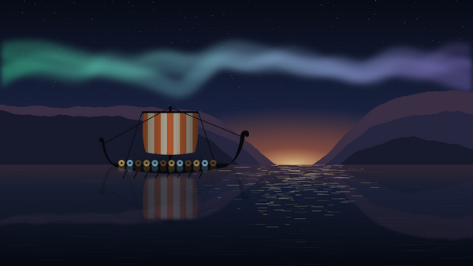

# ᛃᚷᚷᛞᚱᚨᛋᛁᛚ Yggdrasil OS

A Viking-themed Linux gaming desktop, built on [Bazzite](https://bazzite.gg)
(Fedora Atomic + KDE Plasma + NVIDIA drivers + Steam) with
[BlueBuild](https://blue-build.org). GitHub rebuilds it every night on top of
the latest Bazzite, and installed machines update themselves from it.



## What's in it

| Piece | What you get |
|---|---|
| Boot splash | The world-tree emblem fades in and the runes ᛃᚷᚷᛞᚱᚨᛋᛁᛚ kindle one by one (also handles disk-encryption passwords) |
| Login & lock screen | *Fjord at Dusk*: a longship under the aurora |
| Plasma loading screen | The emblem rises while the rune name is carved in |
| Colours | **Yggdrasil** scheme: iron & night-blue surfaces, bone text, gold accent, frost links, ember warnings |
| Wallpapers | *Fjord at Dusk*, *The World Tree*, *Forged Iron* (all original, generated by `tools/art.py`) |
| Icons | **Yggdrasil** theme: Papirus-Dark with oak-brown folders, carved longship-shield Sleep / Restart / Shut Down / Other buttons on the login and lock screens, world-tree app-menu button |
| Font | **Yggdrasil Runic**: Latin A–Z drawn like carved runes (no horizontal strokes, as if cut across the wood grain), small-caps lower case and the Elder Futhark; used for window titles and the panel clock, and available in every font picker (`tools/font.py`) |
| Sounds | War horn at login, anvil strikes for warnings and errors, oak knocks for devices (all synthesised by `tools/sounds.py`) |
| Terminal | Yggdrasil Konsole colours, rune prompt `ᛃ user@host ~ ᚱ`, world-tree `fastfetch` the first time you open a terminal |
| Names | Steam → **Valhalla**, Konsole → **Rune Console**, Dolphin → **The Hoard**, System Settings → **The Forge**, System Monitor → **Heimdall**, Bazaar → **Trading Post** (search still works with the old names) |
| About page / hostname | "Yggdrasil OS – Forged on Bazzite", default hostname `yggdrasil` |

## Images

| Image | For |
|---|---|
| `ghcr.io/ozorhaar/yggdrasil-os` | NVIDIA GTX 16xx, RTX 20xx and newer |
| `ghcr.io/ozorhaar/yggdrasil-os-nvidia-legacy` | NVIDIA GTX 900 / GTX 1000 |

## Install

1. Install **Bazzite** for NVIDIA from <https://bazzite.gg> (Desktop, KDE Plasma).
   If Secure Boot is on, enroll the key when asked (password `universalblue`).
2. Switch to Yggdrasil. The first switch is unverified so the signing keys can install:
   ```bash
   sudo bootc switch ghcr.io/ozorhaar/yggdrasil-os:latest
   systemctl reboot
   ```
3. Switch to the signed image so every future update is verified:
   ```bash
   sudo bootc switch --enforce-container-sigpolicy ghcr.io/ozorhaar/yggdrasil-os:latest
   systemctl reboot
   ```

Updates then arrive automatically (or run `ujust update`). If an update ever
misbehaves, pick the previous entry in the boot menu, or run `ujust rollback-helper`.

## Handy commands

```bash
yggdrasil-theme                     # re-apply the whole look for your user
yggdrasil-theme wallpaper WorldTree # Fjord | WorldTree | Iron
yggdrasil                           # world-tree system info
```

* Turn off the login horn: System Settings → Autostart → *Yggdrasil war horn*.
* Plain prompt: `export YGG_PLAIN_PROMPT=1` in `~/.bashrc`. No greeting: `YGG_NO_GREETING=1`.
* Login screen colours: System Settings → Login Screen → *Apply Plasma Settings*.

## Hacking on it

* `recipes/common.yml`: packages and build steps shared by both images
* `files/system/`: files copied straight into the OS
* `files/scripts/yggdrasil-build.sh`: branding, defaults, boot splash, initramfs
* `tools/render.sh`: regenerates every wallpaper, icon, splash image and sound from code
  (needs python3 + numpy + Pillow, rsvg-convert, ImageMagick, ffmpeg)

## Signing

Builds are signed with cosign. The private key lives only in the repo secret
`SIGNING_SECRET`; `cosign.pub` is committed so machines can verify updates.
